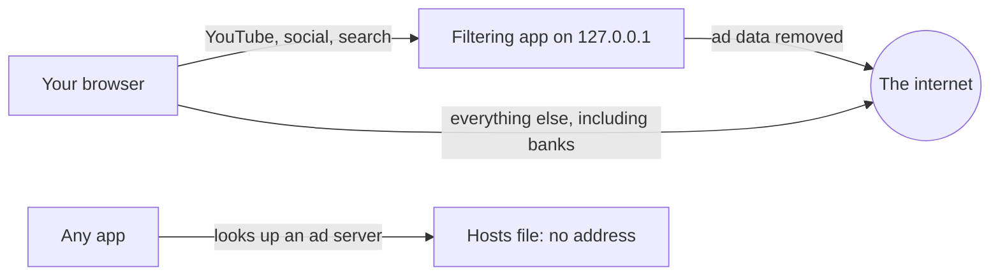

# Local Ad Blocker

**A private, one-click ad blocker for your whole Windows PC, YouTube included.**
No filter lists, no accounts, no telemetry. Everything runs on your computer, and nothing it sees ever leaves it.


## Why it's different

- **One click on, one click off.** No browser setup, no settings to learn. It starts by itself when you sign in to Windows.
- **Whole PC, not just one browser.** It blocks ad servers for every app, removes YouTube and social media ads in your browsers, and switches off the ads Windows shows in Start, File Explorer and the lock screen.
- **Nothing leaves your computer.** It has no updater, no analytics and no cloud service. It never logs or stores what you browse.
- **Written from scratch.** Every rule and script is hand-written for this project. It uses no community filter lists and no third-party code: just Python's standard library.
- **Careful with your security.** Banking, shopping, email and sign-in pages never pass through it, and its certificate can never be used for any other site (see [Security](#security)).
- **Faster pages.** In our tests, CNN fully loaded in 2.4–3.1 seconds instead of 8–22, because the ads never download.

## Quick start

**You need:** Windows 11 and [Python 3.12](https://www.python.org/downloads/) from python.org, with **"Add python.exe to PATH"** ticked during setup. It was developed and tested on Windows 11. Windows 10 will probably work but hasn't been tested.

1. Download this project (**Code → Download ZIP**, then extract it, or use `git clone`) and put the folder somewhere permanent. The app runs from that folder.
2. Double-click **`Turn ON ad blocker.cmd`** and click **Yes** when Windows asks for permission.
3. Close and reopen your browsers.

That's it. The window shows the result and closes by itself. It only stays open if something went wrong, so you can read what happened.

**To turn it off,** double-click **`Turn OFF ad blocker.cmd`** and click **Yes**. That removes everything Turn ON added: the certificate, the proxy setting, the startup entry, the ad server list and the Windows settings.

**To see what's on** at any time:

```bash
python proxy/install.py status
```

## What it blocks

No single method removes every kind of ad, so it combines three:

| Layer | Reaches | Removes |
|---|---|---|
| Ad server list (hosts file) | Every app that uses Windows name lookups | Ads and trackers from about 900 known ad servers |
| Filtering app (local proxy) | Edge, Chrome and other apps that follow the Windows proxy setting | YouTube video ads, sponsored posts in social feeds, search ads |
| Windows settings | Windows itself | Suggestions in Start, ads in File Explorer, lock-screen promotions, tips |

## How it works



- **The filtering app** is a small Python program that runs in the background and only accepts connections from your own PC. Windows sends it only known ad servers and the listed sites: YouTube, Twitch, Facebook, Instagram, X, TikTok, Pinterest, and Google, Bing and DuckDuckGo search. It refuses the ad servers. On the listed sites it blocks ad requests and adds hand-written scripts to each page as it streams through. Those scripts remove ad data before the page uses it, hide leftover ad slots and get past any video ad that slips through. Every other site connects directly, as if the app weren't there.
- **The ad server list** adds a clearly marked block to Windows' hosts file, so any app that tries to reach a known ad server gets no address.
- **Windows settings** are changed per user and backed up first, so Turn OFF can put them back exactly.

If the filtering app ever stops, browsing carries on normally. Listed sites simply connect directly until it starts again.

## Security

To read the listed sites, the filtering app needs a certificate that Windows trusts. That's the risky part of any tool like this, so it's contained:

- **Nothing new can ever be issued.** During setup, the certificate's private key signs one certificate for the listed sites and is then destroyed, without ever being saved to disk. Even someone with full access to your PC couldn't use it to create a certificate for your bank. Its name constraints also limit it to the listed sites.
- **Only listed sites are read.** On those sites, what you type, including passwords and messages, passes through the app on your PC. Banks, shopping, email and account sign-in pages never touch it. The full list is in [`proxy/app.py`](proxy/app.py).
- **Nothing is kept.** The app stores and logs nothing, and it listens on your own PC only.
- **Easy to check, easy to remove.** It's all plain Python and PowerShell you can read, and one double-click removes it completely.

Some security software warns about hosts file or certificate changes, because malware makes similar changes. These changes only ever come from running the Turn ON file.

## Speed

Measured on our test PC, with pages already cached:

| | Without blocking | With Local Ad Blocker |
|---|---|---|
| YouTube, time to first data | about 0.2 s | about 0.2 s |
| CNN, fully loaded | 8–22 s | 2.4–3.1 s |
| YouTube video with an ad due, until it plays | about 20 s, with the ad | 9–18 s, with no ad |

Your numbers will vary with your PC and connection.

## Limitations

We'd rather be upfront:

- **YouTube's wait.** When YouTube decides to show an ad, its server holds the video back for about the ad's length, even when the ad is blocked. You see a short spinner instead of the ad. Brave users report the same.
- **YouTube's "ad blockers aren't allowed" message.** YouTube can flag a signed-in account and attach this message to every video. If that happens, the blocker closes the pop-up and the video carries on. YouTube's terms don't allow ad blockers, and it could make this stricter at any time.
- **Apps that ignore the Windows proxy setting** can still show ads that come from their own servers.
- **Empty ad boxes** can remain on sites outside the list. The ad is gone, but its space isn't. The optional browser extension hides these.
- **Sponsored links** that go through a blocked ad server won't open.
- **Ads stitched into a video stream** on some streaming services, and **sponsor segments** that creators record into their videos, can't be removed.
- **No automatic updates.** That follows from sending nothing anywhere. When a platform changes how it serves ads, some can return until the rules here are updated.

## Optional: browser extension

You don't need it, but it adds a pop-up with a per-site off switch, click-to-hide for anything on a page, and hiding of empty ad boxes on every site. To add it to Edge or Chrome, double-click `optional\Load extension in browsers.cmd` and follow the steps.

## Android (experimental)

An Android version is in [`android ad/`](android%20ad/), with its own README. It blocks ad servers across apps and browsers, needs no root, and starts by itself when the phone restarts. It's built but hasn't been tried on a real phone yet.

## FAQ

**Does it send my data anywhere?**
No. It makes no network requests of its own: no updates, no analytics, no remote settings. The only traffic is your own browsing.

**Is installing a certificate safe?**
It's the part to think about, and the reason the private key is destroyed during setup. The certificate can't be used to create new certificates, and banks, shopping and sign-in pages never go through the app. See [Security](#security).

**Does it work in Firefox?**
Partly. The ad server list blocks ad servers in Firefox too, unless Firefox's DNS over HTTPS setting is on. The filtering app was tested in Edge and Chrome.

**Can I add my own rules?**
Yes. See below.

## Changing the rules

The rules are plain text files in `rules-src/`. After editing them, rebuild, then run **Turn ON ad blocker** again:

```bash
python tools/build_rules.py
```

| File | Purpose |
|---|---|
| `rules-src/ad-domains.txt` | Ad network domains to block |
| `rules-src/pc-hostnames.txt` | Exact ad hostnames for the hosts file, which can't match subdomains |
| `rules-src/android-domains.txt` | Extra ad domains for the Android app |
| `rules-src/url-patterns.txt` | Ad URL patterns |
| `rules-src/surrogates.txt` | Harmless local stand-ins for ad libraries, used by the extension |
| `rules-src/cosmetic/*.txt` | Page elements to hide, one file per site |
| `rules-src/sites.json` | Which scripts and styles apply to which sites |

Per-site page logic is in `extension/content/`, and the filtering app uses those same files. To find new ad hostnames, run `python -m tests.live.harvest_hostnames`.

## Project layout

| Folder | What's inside |
|---|---|
| `proxy/` | The filtering app, its installer and certificate maker |
| `pc-wide/` | The hosts file block and the Windows ad settings |
| `extension/` | The browser extension, whose page scripts the filtering app reuses |
| `rules-src/` | Every rule, hand-written |
| `tools/` | The rule compiler |
| `tests/` | Unit tests, browser tests and live checks |
| `android ad/` | The Android version |
| `docs/` | Design notes and the decisions behind them |

## Running the tests

The tests need only Python and Microsoft Edge. Browser tests use a temporary profile, so your own profile is never touched.

```bash
python -m unittest discover -s tests -t .
```

To check that everything Turn ON sets up is in place on your PC:

```bash
python -m tests.live.installed_check
```

Live checks visit real sites, with and without blocking. Turn the ad blocker off first for a fair comparison, because the "without" side would otherwise be blocked too:

```bash
python -m tests.live.speed_check
```

```bash
python -m tests.live.proxy_check
```

```bash
python -m tests.live.youtube_compare
```

```bash
python -m tests.live.site_check
```

```bash
python -m tests.live.pc_wide_check
```

## Contributing

Issues and pull requests are welcome, especially new ad rules and fixes for sites that change how they serve ads. One ground rule keeps the project what it is: **every rule is written here.** Please don't import community filter lists or add third-party code or services.

## Disclaimer

This is an independent project, not affiliated with or endorsed by YouTube, Google, Microsoft or any other company named here. Their names and trademarks belong to their owners. It's provided as is, without warranty, so use it at your own risk.

## License

[MIT](LICENSE)
